  

  

  

    I'm a BCA graduate and Full Stack Developer who enjoys turning ideas into fast, responsive and well-structured web applications.
    I build with <b>React.js, Node.js, Express.js and MongoDB</b>, and I also have hands-on experience with <b>Django</b> and MVC architecture.
    I'm a quick learner, detail-oriented, and comfortable communicating technical ideas clearly in a team.
  

  

    
    
    
    
  

<h3>🌐 Connect with me</h3>

  
  
  
  

  

 

---

## 🛠️ Tech Stack

<table>
<tr>
<td width="50%" align="center">
<h3>🎨 Frontend</h3>

</td>
<td width="50%" align="center">
<h3>⚙️ Backend</h3>

</td>
</tr>
<tr>
<td width="50%" align="center">
<h3>🗄️ Database</h3>

 Basic SQL: SELECT, JOIN, CRUD
</td>
<td width="50%" align="center">
<h3>🧰 Tools</h3>

</td>
</tr>
</table>

**Core concepts:** REST API Development · CRUD Operations · MVC Architecture · Responsive Design · Version Control

---

## 💼 Experience

**Full Stack Developer Trainee (MERN Stack) — Luminar Technolab, Kochi**
`May 2025 – Feb 2026`
- Built full-stack applications using MongoDB, Express.js, React.js and Node.js
- Integrated REST APIs and implemented CRUD operations with MongoDB
- Used Git for version control and collaborative development

**Full Stack Developer Intern — Grapesgenix Technical Solutions Pvt. Ltd, Thrissur**
`Dec 2024 – Mar 2025`
- Developed backend logic, routing and database operations using Django
- Applied structured MVC architecture in application development
- Coordinated with the team and delivered task updates on time

---

## 🚀 Projects

### 🧠 BrainBox — Smart Study Notes Management App
> A MERN stack application that helps students organize and manage study materials efficiently.

- Responsive React frontend with structured component architecture and dynamic state management
- Node.js and Express backend handling user data and application logic
- MongoDB for efficient storage and retrieval of study resources

`React` `Node.js` `Express` `MongoDB`

### 🛡️ Spam Shield — Spam Detection Web App
> A web application that identifies spam messages and unknown phone numbers.

- Dynamic form validation and state management for real-time user feedback
- Reusable components that handle multiple input scenarios
- Responsive UI with cross-browser compatibility

`React` `JavaScript` `CSS`

---

## 🎓 Education

**Bachelor of Computer Applications (BCA)** — Mahatma Gandhi University, Kerala `2022 – 2025`

---

## 📜 Certifications

- 🏅 **MEAN/MERN Full Stack Development** — Luminar Technolab, Cochin · Grade A+ · 7 Months (Feb 2026)
- 🏅 **MEAN/MERN Full Stack Development** — NACTET (Affiliate: Luminar Technolab) · Grade A+ · 6 Months (Nov 2025)
- 🏅 **Full Stack Application Development (Django)** — Grapesgenix Technical Solutions Pvt. Ltd (2025)

---

## 📊 GitHub Stats

  
  
   
  

---

  <h3>💬 Let's build something great together!</h3>
  

